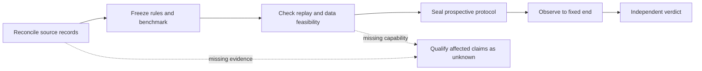

# Research plan: reconciled results, fixed rules and a fair bot-trade comparison

**Document:** PLAN-20261031-VALIDATION. **Prepared:** 31 October 2026, 06:57 SGT.
**Authority:** owner “Proceed to research and plan §6”, following №17,941 §6; research updates №17,942–17,946 §1. By <Codex (GPT-6), effort: not exposed>.

**Status: researched proposal, not an activated experiment or a financial PASS.** Publication records the plan and evidence. It changes no application code, registration, account, order, stop, size, risk setting, worker permission or schedule. Existing owner-authorised live trading and exits continue. Research gates below govern the conclusions that may be claimed, not permission to pause trading.

## §P1. Decision, scope and invariants

Determine whether a precisely identified Jiaoyi strategy produces a qualified after-cost edge and whether it improves on a specified bot-trade baseline under comparable conditions. The immediate deliverable is a reconciled evidence ledger and executable study specification—not a fifth rewrite, a new agent framework or a promise to recover losses.

Preserve the [factory charter](factory-charter.md): risk:reward **1:1.38** and **at least 73% net wins over the latest 20 fully closed owned positions per strategy/account**; 15/20 is the first passing count. Retain losses and unknowns. Planned geometry, realised payoff and win rate are separate. Preserve the live one-broker-minimum-position rule, existing 10% minimum-contract risk cap, 250% margin floor, external-position exclusion and owner-only pause authority. No Strategy 2, stock/dividend routine, new service or paid API fallback is activated.

Time is Money: reuse the existing broker/store/statement evidence, assign bounded work and fix only demonstrated defects. An unavailable optional metric does not prevent reporting other qualified facts. A normal loss does not automatically justify changing a strategy.

## §P2. Research findings and evidence limits

| Finding | Evidence inspected | Consequence |
|---|---|---|
| Current outcome remains below the owner goal | `/operations/reports` retrieved 31 Oct **06:49:37 SGT**: qualified S3 latest-20 wins remain **3/5/4/1** for live 43002148 and demos 46130058/47790949/49236051. Live S1 is UNKNOWN; other S1 windows have no measured closes. | No goal improvement or current-rule edge is established. These S3 windows span retained opening versions, not an isolated v6 experiment. |
| The exports overlap and end too early | Eight original CSVs contain 610 closing rows but **430 distinct account+DealID pairs**; 180 overlapping rows match exactly. The 29 Oct files contain 60 newer-only rows and omit 190 older rows because their ranges are narrower. | Do not sum exports, subtract whole-export totals or count deals as fully closed positions. |
| Current financial exceptions are absent from those files | Latest closes in the newer exports are 28 Oct 20:02–22:04 SGT. They precede the later v6 activation and do not cover the 30 Oct NatGas event. | Fresh broker evidence is required; the old files cannot certify subsequent results. |
| NatGas ownership exists but quantities do not reconcile | Live S1 position **637255862**, original request/reported fill **10000 broker cents of units**. The quality assessment rejects opening/closing quantity inconsistencies. The legacy −2.54639R headline is unqualified. This was observed before PR138 started. | Resolve the exact deal/receipt/revision rows first. Do not infer a missing original intent, reversal, manual contamination or duplicated pagination. |
| Account metadata disagree | Both live CSV filenames state 1:100; archived broker profile at 30 Oct ~21:18:36 SGT is HEDGED, `leverageInCents=20000`, i.e. 1:200. Other archived profiles show demos 1:200/1:25/1:200. | Resolve timing from broker profile history. Filename leverage is neither current broker evidence nor measured portfolio leverage. |
| The retained bot-trade baseline is not comparable as supplied | Its 1 Oct derived statement baseline includes older live **42993489 in SGD**, different periods/accounts and missing position/strategy identity. Some current demo accounts were used by both programs. | Account names and generic API channels do not establish program ownership. A fair relative-performance verdict is presently **Not Verifiable**. |
| Existing cost evidence is limited | The reconciled 75-position legacy cohort has 22 quote-referenced exits, 44 stop-trigger references and 9 unknown exit references; none has the current v6 opening hash. Bot-trade's shadow defaults and momentum reserve also have different provenance. | Do not combine unlike slippage references, treat placeholders as measurements or reduce the current reserve to admit more trades. |

Source baseline: Jiaoyi **`132a0dde1ce94b24d53dc2ab0b7f47c7f5e418ca`**, deployed by PR138; S3 v6 **`d54344b9d463532c3b1e2d81bd07d671ed0d2fceae9ee923f1c8988b18b2ab32`**. Bot-trade repository main was refreshed to **`20bca9026a84d65c4d08f03b4f1674aa86222063`**, one documentation-only commit after `2be966e`. Repository identity does not establish historical deployment/settings identity. The nine failed legacy H1/S1 development trials remain failed; they are not a test of active S3.

### Statement inventory: closing-deal grain

| Account / environment | 27 Oct rows | 29 Oct rows | Identical overlap | Newer-only | Latest newer-export close, SGT |
|---|---:|---:|---:|---:|---|
| 43002148 live | 16 | 19 | 16 | 3 | 28 Oct 20:02:51 |
| 46130058 demo | 167 | 78 | 59 | 19 | 28 Oct 21:27:03 |
| 47790949 demo | 118 | 76 | 56 | 20 | 28 Oct 22:04:33 |
| 49236051 demo | 69 | 67 | 49 | 18 | 28 Oct 20:05:13 |

All eight files have USD monetary headings. They include different grains: closing deals, position/order snapshots, balance/summary and sometimes transactions. They do not establish complete funding coverage or exact NY-close marks. Older ranges start before the new system; unmatched activity is not automatically bot-trade.

## §P3. Work order and completion gates

The diagram governs research. It neither stops the current trader nor creates a second broker writer.

| Milestone / responsible role | Concrete output | Exit and time discipline |
|---|---|---|
| **M0 — Main coordinator: this plan** | Sources, findings, scope and handover on main; no activation | Done when reviewed and published. Financial acceptance stays open. |
| **M1 — Ledger specialist + independent checker** | NatGas source reconciliation; original-version position ledger; whole-account balance/float/flow bridge; exception inventory | First bounded session of up to 2 hours **after required source access/files arrive**. Return qualified results or exact missing IDs/intervals; do not wait silently or force balances to reconcile. |
| **M2 — Coordinator + benchmark reviewer** | One immutable candidate/baseline/metric/data manifest and an implementation-readiness table | One bounded specification session after M1's relevant inputs. Missing comparator provenance blocks only comparative claims. |
| **M3 — Execution/data reviewers** | Verified replay semantics and data-availability/cost/dependence assessment; minimal implementation tickets if capabilities are absent | Start with existing historical/development evidence. A proposed two-complete-week unscored availability review is a checkpoint, not an edge test or a promise of sufficient variance data. |
| **M4 — Statistical reviewer + coordinator** | Sealed primary metric, effect/precision requirement, week count, T0/Tend, counts, seeds and interpretation | Complete **before fresh scored observations**. Duration is derived from frequency/dependence and precision/power; it cannot honestly be promised today. |
| **M5 — Observer + independent reproducer** | Fixed-horizon result and all registered gates, adverse cases and missingness | Daily factual monitoring; one primary inference at the sealed end. PASS / FAIL / INSUFFICIENT / NOT VERIFIABLE, separately for each claim. |

Sub-agents analyse bounded assignments; the coordinator resolves discrepancies by evidence IDs. Another model agreeing with an explanation is not independent financial validation. Completion requires reproducing the calculation, source joins and relevant event path.

## §P4. M1: reconstruct the ledger before interpreting losses

**Audit window proposed:** NY-close 23 October through NY-close 30 October 2026, corresponding to **24 Oct 05:00–31 Oct 05:00 SGT**. Use actual available observation times and disclose gaps. Expand backwards only for positions carried into the window and their original risk/ownership. Later forward scoring has a new T0; this historical week is already observed development evidence.

Keep two views:

1. **Whole-account economics:** every position and order, including external/manual activity; real live capital and demo balances remain separate. Account P&L equals closing equity minus opening equity minus signed net external inflows over the exact mark interval. Do not treat deposits, withdrawals or transfers as trading returns. Retain operation counts even if net flows cancel. Broker net float may exclude potential closing commission: balance plus that float is an **NLV proxy**, not guaranteed liquidation cash. Verify currency, credit/bonus treatment and close costs; otherwise label the limitation. Time-weighted returns require sufficient valuations and flow timing; do not fabricate daily/MTD/YTD returns from incomplete totals.
2. **Owned strategy outcomes:** join account+deal ID to position, original opening intent/receipt, strategy, settings and opening version. Reconstruct all partial fills and closes; a mobile close can still close a program-opened position. A generic API channel is insufficient attribution. Mixed owners, extra scale-ins or multiple opening intents need allocation evidence; otherwise retain UNKNOWN.

A qualified position needs exact attributable volume balance, terminality, positive original risk, complete net charges and covered/revision-aware history. A partial close is not one completed trade; closing volume above opening is not a qualified result. Do not use a tightened stop as initial R, cap an inconsistent risk share, drop a later unqualified close to retain an older passing window, or replace a missing fee with zero. Original account/deal IDs deduplicate deals; execution notifications and revisions retain their separate identities.

Official cTrader definitions distinguish submitted `volume`, `filledVolume` and `closePositionDetail.closedVolume`, expressed in cents of units. Inspect these fields and original raw messages for disputed deals rather than assuming they are interchangeable. Primary-key upserts mean repeated pagination alone does not duplicate an unchanged deal ID. No particular cause of NatGas is established until those rows reconcile.

**Minimum extraction, using existing tables:**

- Start with account 43002148 / position 637255862: all related intents, receipts, broker deals and `deal_changed` revisions, with source IDs, timestamps, quantities, status, raw-byte availability and original risk/settings. Use a read-only transaction and a short statement deadline; caps of 201 intents/revisions and 1001 events/deals detect overflow rather than silently truncate it.
- Map the 430 observed statement deal IDs in bounded batches to complete position lifecycles. Keep original export fingerprints and known revisions. Read raw payloads only for disputed IDs; no tick-archive expansion or new telemetry schema.
- Read existing account/profile and retained close snapshots for the audit window. Retrieve the exact cashflow operations for mark intervals where coverage/reconciliation requires them, respecting the broker API's request-span limits. Missing source operations are an accounting gap, not zero flows.
- Use Decimal cash arithmetic and verified broker charge semantics. CSV net values already include their stated charges; actual executable fills already include their spread. Do not deduct those costs twice.

**Access gap:** the prior normal Railway SSH attempt had no existing SSH identity; the database is private. Do not redeploy the worker with a diagnostic start command, create an endpoint or change networking merely to fetch this evidence under a planning task. Fresh broker exports and an approved read-only query/export path are the two practical inputs. Unaffected qualified reporting continues while this gap remains.

## §P5. M2: freeze one executable hypothesis

A fixed algorithm may still update its bands, Chandelier, registered Kelly state and account book. Freeze the update rules and initial state, not the market or legitimate exits.

The manifest must identify:

- Deployed implementation/image and source, opening registration, settings version and their effective intervals. Pin v6 with its v5/v4 inheritance; old v4 “no trailing” wording does not override v5 exits. S1's public projection does not expose an equivalent entry hash: establish intent/settings/deployment provenance rather than invent one.
- Universe and account-specific symbol mapping; currencies, contract/lot units, tick/minimum/step sizes, session calendars, contemporaneous margin/leverage, original risk and permitted capacity. No China expansion or new assets are implied.
- Inputs and availability times: bid/ask, event/receipt timestamps, warm-up, gaps, corporate/roll adjustments and provenance. Use NY 17:00 for reporting with `America/New_York`; do not hard-code SGT offsets through DST.
- Costs, fills, latency, initial holdings/adaptive state, versioned analysis method and seeds. Retain original opening cohorts and the implementation/settings governing every exit or amendment. A lifecycle managed across a semantic change is hybrid: keep it in historical accounting, but do not certify it as a fixed-policy observation merely because its opening hash is unchanged.
- For any model-driven bot-trade decision: model/provider revision, prompts, tool schemas, contemporaneous context/news, outputs and overrides. A repository SHA or random seed does not reproduce missing model decisions. Do not ask a present model to reconstruct a historical plan using later knowledge.

Critical repairs retain earlier results and an explicit version transition. A semantic change starts a new research epoch and appropriate registration; it never erases a losing trial. No new parameter or strategy is proposed for activation by this plan.

## §P6. M3: make the comparison fair and feasible

| Study | Matching required | Conclusion permitted |
|---|---|---|
| Historical accounting | Same period/marks, documented program ownership, opening/closing float, cashflows, currency and contemporaneous exposure | What each account/program earned or lost, with explicit confounders; no universal AI/language verdict |
| Strategy counterfactual | Two frozen policies; same information-time market input, starting capital/state and feasible common risk/capacity; shared credible execution/cost model | Conditional simulated policy difference, not historical reality or guaranteed live returns |
| Execution comparison | Same archived intents and broker-response/failure schedule through broker-free adapters | Correctness and queue/decision/send/ack/protection latency differences; no alpha claim |
| Prospective shadow | Decisions recorded before outcomes, fixed policies/data/score period; virtual fills clearly marked | Forward simulated evidence with documented fill/impact limits; no second live executor |

The full historical bot-trade adapter, deployment binding and model context are **not established as available**. Publish a readiness table before commissioning implementation. Reuse mechanisms only after source and failure checks; no framework migration is required.

Match intended risk and actual feasible exposure, not raw dollars or advertised broker leverage. Preserve minimum/step constraints and the live account-wide one-position rule in a broker-feasible portfolio comparison. Any fractional-size “unit risk” diagnostic is a separately labelled simulation, not an executable trade. Distinguish native historical performance from a normalised counterfactual that applies a different risk budget to bot-trade.

Evaluate the **full predetermined opportunity stream**, including no signal, cost/margin/session veto, unavailable input, unfilled/rejected/partial orders and positions still open at cutoff. Do not select only symbols or trades both programs entered. Retain copied-signal clusters and common market-event dependence across assets/accounts.

Use executable quote sides; model gaps beyond stops, latency, partials, financing and conversion. cTrader quote ticks do not prove depth, queue priority or market impact. Preserve quote-to-fill slippage, stale-proposal deviation and stop-trigger gap as distinct measures. Bot-trade's shadow file labels 0.5 bps/side and 250 ms as assumptions; its separate 24 bps reserve derives from sparse entry/proposal evidence. Neither is universal calibration. Jiaoyi's 24 bps/side remains unchanged; compare declared cost sensitivities without choosing the best result afterwards.

## §P7. M4–M5: acceptance and stopping rules

Three claims require separate verdicts:

1. **Owner goal:** the qualified latest 20 per strategy/account, ≥15 net wins, with original risk and the 1:1.38 geometry/payoff reference separately reported. Preserve the official historical windows. An IID illustration gives a Wilson 95% interval of roughly **53.1%–88.8% for 15/20**; this is not an interval for correlated Jiaoyi trades. The win count alone is not a joint goal pass: report the qualified realised net-R payoff against 1.38 and planned geometry separately. A passing window alone does not establish repeatability.
2. **Absolute S3 edge:** preserve all inherited criteria: ≥200 trades; mean net R>0; its **2.5th-percentile lower bound** from 10,000 week-block bootstrap resamples>0; mean net R above the 95th percentile of 1,000 same-decision-time random-direction controls; PF≥1.3. Keep per-account counts and unique-episode counts. The registration says copied fills are one sample for a rule claim; the conservative proposed rule-level interpretation is **200 qualifying signal episodes**, explicitly sealed before scoring. It does not certify that every account has 200 closes. S1's original H1 floor is 80, with separate failed development gates and later live amendments; S1 is not silently pooled into S3.
3. **Improvement over bot-trade:** proposed primary comparison is paired daily net portfolio return difference on the declared common budget, including marked open exposure and no-trade days, resampled by common weeks. Require positive, sufficiently precise excess return plus a separately qualified absolute result; beating a losing comparator is not proof of profitability. Declare meaningful effect/precision, drawdown interpretation and the multiple-account/claim policy before scoring.

Retain the existing **ISO entry-week** grouping for registered trade-R inference; weeks without entries are excluded by that existing statistic. For the separate portfolio comparison, include all predetermined calendar days/weeks, including verified no-trade periods. Resample the same block indices across instruments/accounts and benchmark streams. The bootstrap can mechanically return a bound with one week; such a result does not establish adequate uncertainty. Two hundred copied or concentrated trades cannot replace sufficient calendar coverage. Deduplicating episodes does not establish independence. Assess holding periods and dependence extending beyond one ISO week before M4; retain the registered statistic, but qualify edge inference as INSUFFICIENT if its block assumptions are unsupported. Do not select a block length because it passes.

The unscored feasibility/pilot work estimates eligible episode frequency, paired weekly variance and dependence; its observations are excluded from scoring. Anchor the smallest meaningful excess-return effect to specified economics and cost uncertainty, not the pilot's best observed return. Before T0, seal a conservative week-based duration/power design, fixed Tend, random seeds and handling of insufficient coverage. An 80% planning-power target is a **proposed research setting**, not a live risk limit or claimed probability of profit. No defensible completion date is available before those inputs. At Tend, missing count/block/quality evidence means INSUFFICIENT or NOT VERIFIABLE. Do not extend the same study until it passes. Any extension requires fresh prospective data, predeclared carry-over/pooling rules and a continuing test-family error policy, while retaining the first result. Renaming a study does not reset selection bias.

The 1,000 direction controls must replay the side-dependent prices, costs and path-dependent exits. Negating finished net P&L is invalid. The existing H1 control runner does not certify a v6 evaluator. Resolve beforehand the conflict between fixed candidate entry times and a random control whose previous position is still open: a conditional isolated-entry direction test and a capacity-constrained portfolio test are distinct. An unimplemented valid control leaves that gate Not Verifiable.

The scored closed-trade cohort comprises positions opened in **[T0, Tend)** under the sealed version/risk rules; carry-ins remain separately identified. At Tend, mark open positions in portfolio economics and retain their right-censored status for closed-position inference; specify the exit-follow-up boundary before T0. Unresolved censoring at the sealed follow-up boundary prevents the affected closed-trade PASS. Do not force a live close or drop an open loser. Keep zero trades, zero losses, unavailable costs and undefined payoff/PF distinct; infinity or a missing denominator does not supply all other acceptance evidence.

Daily reports may disclose data faults and progress, but cannot declare inferential success at the first favourable window. Preserve all tried hypotheses, versions, rejected variants and viewed periods. Four rebuilds are not the full trial count. PBO/Deflated Sharpe diagnostics require the necessary trial history and return matrix; do not invent a selection-adjusted score from incomplete records. The known historical losses and 75-case cohort are development evidence, never an untouched holdout.

## §P8. Immediate handoff and reporting

**Next task:** obtain current broker evidence for M1, beginning with the NatGas case. Request exports through **31 Oct 05:00 SGT**, including openings/partial closes for carried positions and funding/fee operations; retain each export's actual selected period and timezone. Obtain the book and valuation **at that cutoff** from retained marks or broker-supported historical evidence. A separately timestamped current open-position/pending-order snapshot supports current accounting, not reconstruction of earlier float. If cutoff marks are unavailable, cutoff float/NLV remain unknown. Recover bot-trade's contemporaneous intent/plan/deployment receipts for one named comparable interval. If those records do not exist, historical causal comparison closes as Not Verifiable; independent Jiaoyi accounting still proceeds.

A source-complete extraction can support a narrowly scoped correction if it demonstrates a defect. Before implementation, specify the failing case, expected accounting/protection behaviour and counterexamples: valid partial fill, broker-side SL/TP exit and a revised/conflicting deal. Missing fields alone are not authority to rewrite broker facts or weaken qualification.

The daily research readout should contain only: per-account latest 20/coverage; qualified net expectancy and paired comparison with uncertainty when available; milestone/unknowns/next action. No per-stop-loss Telegram, no continuous model loop, no new raw tick warehouse. Minimum retained artifacts are source hashes/coverage, position+episode ledger, paired daily/weekly series, immutable protocol, trial registry and independent verdict. The $40 API ceiling and existing ChatGPT route remain; no new paid calls are needed for the present plan. At 06:49 SGT the worker reported 5/36 sessions and an expired global mutation window; the present research request does not reset that window.

**Human/input dependency for M1:** fresh exports or a permitted read-only private-data path, plus any missing historical bot-trade provenance. M2–M4 can prepare unaffected specifications meanwhile. Scored dates, primary effect and the 200-count interpretation remain visibly unsealed; no paper/comparator service is running and no strategy parameter has been changed.

## §P9. Sources and research checks

1. [Current charter](factory-charter.md), [S3 v4 acceptance](preregistration-2026-10-28-strategy3-v4.md), [v5 exits](preregistration-2026-10-28-strategy3-v5.md), [v6 scope](preregistration-2026-10-28-strategy3-v6.md), [S1/H1 registration](preregistration-2026-10-24.md). These establish definitions and authority, not financial success.
2. [Earlier loss-review protocol](loss-review-plan-2026-10-29.md), [qualified economic assessment](validation-17859-2026-10-30.md), [75-position cost evidence](validation-17887-cost-evidence-2026-10-30.md), and [PR138 release/financial exception receipts](https://github.com/ang-kl/jiaoyi/pull/138). Existing broad plans are reused; this document supplies the missing version/benchmark/prospective gates.
3. [cTrader primary model definitions](https://help.ctrader.com/open-api/model-messages/), read 31 Oct 2026: deal and close quantities, precision, account leverage and cashflow identities. The definitions require checking actual messages; they do not explain the disputed trade by themselves.
4. [Pinned bot-trade handover](https://github.com/ang-kl/bot-trade/blob/20bca9026a84d65c4d08f03b4f1674aa86222063/doc/handover/handover-26_Oct_2026.md), [older statement baseline](https://github.com/ang-kl/bot-trade/blob/20bca9026a84d65c4d08f03b4f1674aa86222063/docs/analysis/gtd-statement-baseline-2026-10-04.json), [release qualification](https://github.com/ang-kl/bot-trade/blob/20bca9026a84d65c4d08f03b4f1674aa86222063/doc/handover/bot-trade-release-delta-2026-10-21.json), [shadow assumptions](https://github.com/ang-kl/bot-trade/blob/20bca9026a84d65c4d08f03b4f1674aa86222063/agent/config/tick-shadow-sim.json), [momentum reserve](https://github.com/ang-kl/bot-trade/blob/20bca9026a84d65c4d08f03b4f1674aa86222063/agent/config/momentum-target-slippage.json). Reviewed source does not establish contemporaneous production identity or a proven edge.
5. Bailey, Borwein, López de Prado and Zhu, [The Probability of Backtest Overfitting](https://www.davidhbailey.com/dhbpapers/backtest-prob.pdf), revised 27 Feb 2015, relevant full-text pp. 3–8. Repeated selection and reused evaluation periods can invalidate nominal success claims. This does not estimate Jiaoyi's PBO without its candidate-result matrix.
6. Bailey and López de Prado, [The Deflated Sharpe Ratio](https://www.davidhbailey.com/dhbpapers/deflated-sharpe.pdf), version 31 Jul 2014, abstract and pp. 6–8. Selection and non-normality matter; the method does not repair missing costs, attribution errors or dependence automatically.
7. [Existing bootstrap implementation](../crates/jiaoyi-core/src/research/bootstrap.rs) and [H1 methodology](../crates/jiaoyi/src/edge/h1job.rs) were inspected, not modified or rerun. No historical held-out seal was opened.

**Checks performed:** original file fingerprints, CSV overlap/revision comparison and 430-deal union recomputed; repository pins and selected source blobs checked; current public reports captured; official protocol definitions and both paper bodies inspected; numerical illustrations reproduced; specialist findings independently challenged. The complete financial ledger, live NatGas reconciliation, full comparator adapter, prospective scoring and economic PASS remain **not completed**.

Bounded private receipts remain outside Git: `validation-statement-inventory-20261031.json`, `validation-broker-profiles-20261031.json`, the three specialist planning notes and `validation-statistics-sources-20261031/` under `/workspace/.jiaoyi-env/`; current public source hashes under `/workspace/jiaoyi-validation-research-20261031/sources.json`. Broker cash figures, raw payloads and credentials are not published here. Missing local receipts on another machine must be retrieved from their authorised originals, not reconstructed as facts.

**Research verdict:** the plan is ready for review and evidence acquisition. A reconciled ledger, comparative advantage and consistent attainment of the owner goal have not yet been demonstrated.
